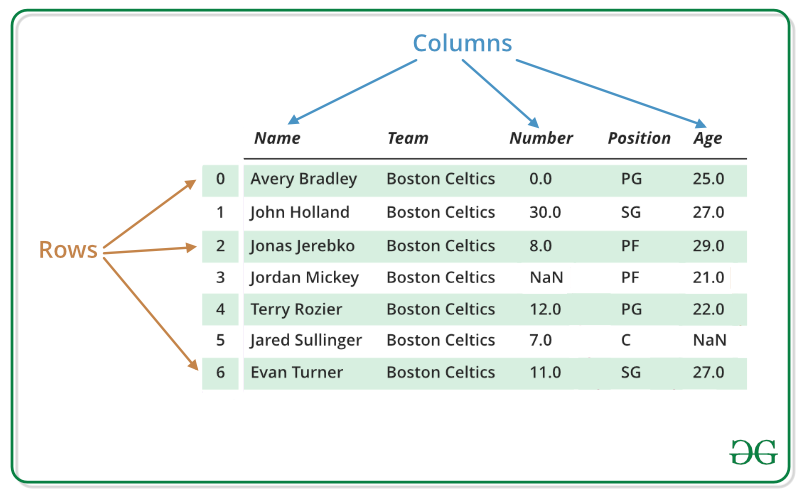
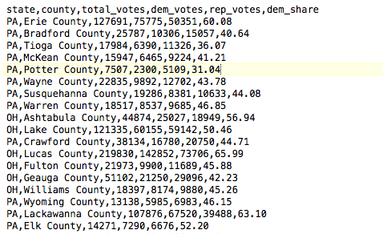

<table style="width: 100%; border-collapse: collapse; border: 1px solid black; font-family: Arial, sans-serif;">
  <tr>
    <td style="width: 16%; padding: 4px; vertical-align: middle; text-align: center; border: none;">
      
    </td>
    <td style="width: 68%; padding: 4px; vertical-align: middle; text-align: left; border: none; font-size: 10pt; line-height: 1.15;">
      Inter American University of Puerto Rico – Bayamón<br>
      Department Of Electrical &amp; Computer Engineering<br>
      COEN 2210: Int. to programming<br>
      Final Project: Oct 2026 | - Prof. Wilson Lozano
    </td>
    <td style="width: 16%; padding: 4px; vertical-align: middle; text-align: center; border-left: 1px solid black; border-top: none; border-right: none; border-bottom: none;">
      <span style="font-size: 16pt;">Pts.</span><br>
      <span style="font-size: 28pt;">100</span>
    </td>
  </tr>
</table>

# CoRe Data Analyzer Application<sup>1</sup>

## 1. Introduction

The Computing Research Lab (CoRe Lab) at the Inter American University of Puerto Rico wants to develop a prototype of a Data Analysis tool with C++. CoRe Lab hired a team of computer engineering students to build their prototype of Data Analysis Tool called CoRe Data Analyzer®. They requested the software to be built in C++ using structures, arrays, functions, and many other essential features of the language.

The program shall allow managing observations in a simulated Data Frame<sup>2</sup> (adding, deleting, and displaying observations). Each row represents one observation, and each column represents a field of that observation. The following image illustrates this organization; the project will use election results rather than the basketball data shown in the example. Image source: https://www.geeksforgeeks.org/dealing-with-rows-and-columns-in-pandas-dataframe/



Due to time and budget constraints, CoRe lab initially only wants to perform a proof of concept test with a specific Data Frame. The Data frame will contain the information for the 2008 election results (swing states). The information for the Data Frame includes:

- Unique id: identifier of the observation
- State: state for the county (PA, OH, FL)
- County: name of the county
- Total votes: total votes in the county
- Democratic votes: votes for the democratic party
- Republican votes: votes for the republican party
- Democratic share: percentage of the votes that went for the Democratic Party.

The lab provides the source code for another application called Basic Integer Calculator® as a reference for organizing functions and building a menu-driven application. Review this code before starting the project. Open the provided calculator folder in VS Code and compile it using the C++ compiler used in this course; the included README provides build and run instructions for Windows and Mac. A representative of the company will meet with you during October 2026 to discuss this sample application and the specification of the new application CoRe Data Analyzer®. The project must be completed by December 2, 2026. Each student must individually demonstrate and explain the application during the project defense.

<sup>1</sup> Adapted from “My Movie project” COEN 2210, year 2015. Professor J. Rodriguez.<br>
<sup>2</sup> A Data frame is a two-dimensional data structure, i.e., data is aligned in a tabular fashion in rows and columns.

## 2. General requirements

The application manages county election results. The supplied `swingStatesDF_50.csv` provides 50 randomly selected observations from Pennsylvania (PA), Ohio (OH), and Florida (FL), preserving their original IDs. The array capacity remains 100, leaving space for manually added observations. When loaded, those observations are stored in an array in memory, where the user can display, search, add, or delete them. Changes in memory are preserved in the file only when the user selects Save.

Each observation in memory includes:

- Unique id
- State
- County
- Total votes
- Democratic votes
- Republican votes
- Democratic share



The historical snapshot above illustrates the election data fields. The supplied `swingStatesDF_50.csv` also includes an `id` column as its first field; the CSV example in section 2.1.7 shows the required format.

This information shall be declared in a C++ structure (`struct`). You shall use the `string` type instead of `char[]` to define string data fields within the structure. To access the string type you shall use: `#include <string>` in your program. The application shall only store a maximum of 100 observations in an array of structures. The structure shall have a `bool` variable to indicate a particular element in the array is empty and can be used to store an observation data. The application functionality is described in the following sections.

Each observation has a unique ID stored in the CSV file. Load preserves the IDs read from the file, and Save writes those IDs back with the observation data. When adding an observation manually, the user enters its ID. Before insertion, search occupied slots for that ID; reject the addition if it already exists. Deleting an observation does not change the IDs of the remaining observations. IDs identify observations and must not be treated as array indices.

Initially, all 100 array slots are empty. Loading or adding an observation marks its slot as occupied; deleting an observation marks that slot as empty and makes it available for reuse. Display, search, and statistical operations must process only occupied slots. The slot's Boolean flag is internal program state and is not saved in the CSV file.

**Input validation:**

- Accept only integer menu options from 1 through 11. Report invalid input and request another option.
- IDs and vote counts must be whole numbers within the range of their declared integer types. Reject letters, fractional input, and out-of-range values rather than silently accepting part of the response.
- Vote counts cannot be negative. Democratic share must be a finite numeric value from 0 through 100, inclusive.
- State and county names cannot be empty. Read the entire county name, including spaces.
- Before inserting an observation, verify that its ID is not already used by an occupied observation and that an empty slot exists.
- When a field is invalid, explain the problem and request that field again. Do not mark the new observation's slot as occupied until all its fields are valid. For a duplicate ID or a full array, use the error-and-return behavior specified in Add.

### 2.1. Main Menu

The main menu provides access to the observations currently stored in memory. “Display Data Frame” lists all occupied observations, while “Display an observation” shows one observation selected by its ID. “Add an observation” first requests an ID and searches for an existing observation with that ID. Only if the ID is not already in use does it collect the county data and insert the new observation. “Delete an observation” removes the observation selected by ID and makes its array slot available again. The state and county search options display all matching observations.

“Save observation to file” writes the current occupied observations to the CSV file, replacing its previous contents. “Load observation from file” replaces the observations currently in memory with those read from the CSV, preserving the IDs stored in the file. Any unsaved additions or deletions are discarded by Load. Adding observations after Load preserves the loaded observations and uses available slots; those additions reach the CSV only when Save is selected.

“Create Histogram (Bonus)” is an optional visualization of democratic share. “Calculate Measures of Central Tendency” calculates the mean, median, and mode for a selected numeric column. “Exit application” ends the program. Keep all 11 menu options and their numbering; option 9 is reserved for the optional bonus. If the bonus is not implemented, selecting option 9 should display a message indicating that the feature is not implemented and return to the menu.

After an operation, prompt the user to press Enter before returning to the menu. The Basic Integer Calculator sample provides a menu and a portable Enter-based pause that can be reused for this project.

**Menu Sample output:**

```text
CoRe Data Analyzer APPLICATION
--------------------------
1. Display Data Frame
2. Display an observation
3. Add an observation
4. Delete an observation
5. Find observation by state
6. Find observation by county
7. Save observation to file
8. Load observation from file
9. Create Histogram (Bonus)
10. Calculate Measures of Central Tendency
11. Exit application
--------------------------
Enter option number:
```

#### 2.1.1. Display Data Frame Option

After loading or adding observations, the user needs to review the dataset currently in memory. This option displays all occupied observations in a table with labeled, aligned columns. Include each observation's ID, state, county, total votes, democratic votes, republican votes, and democratic share; display democratic share with two decimal places. Skip empty slots, including slots made available by Delete. If no observations are occupied, display a message indicating that the Data Frame is empty.

At the end, prompt the user to press Enter to return to the main menu. The Enter-based pause is implemented by the `pressAnyKey` function in the Basic Integer Calculator sample and can be reused.

The display and search examples below illustrate a small dataset containing Erie County and Bradford County with IDs 1 and 2. These examples are independent of the supplied random 50-observation sample. The Add example assumes an available slot and demonstrates a user-entered ID not already present in the dataset.

**Sample output:**

```text
ID   STATE  COUNTY           TOTAL VOTES  DEM VOTES  REP VOTES  DEM SHARE
---  -----  ---------------  -----------  ---------  ---------  ---------
1    PA     Erie County      127691       75775      50351      60.08
2    PA     Bradford County  25787        10306      15057      40.64
-----------------------------------------------------------------------

<Press Enter to continue>
```

#### 2.1.2. Display an observation option

After viewing the table, the user can select one observation by its displayed ID. Search only occupied slots for that ID, then display all fields of the matching observation. An ID is not an array index: deleting a record and reusing its slot does not make those values interchangeable. If no occupied observation matches, display an error and leave the dataset unchanged. Press Enter to return to the menu after either result.

**Sample output (Success):**

```text
DISPLAYING AN OBSERVATION
---------------------------------------------------
Enter the observation id: 2
---------------------------------------------------
ID : 2
STATE : PA
COUNTY : Bradford County
TOTAL V : 25787
DEM VOTES : 10306
REP VOTES : 15057
DEM SHARE : 40.64
---------------------------------------------------
<Press Enter to continue>
```

**Sample output (Error):**

```text
DISPLAYING AN OBSERVATION
---------------------------------------------------
Enter the observation id: 99
---------------------------------------------------
Did not find any observation with that id!
---------------------------------------------------
<Press Enter to continue>
```

#### 2.1.3. Add an observation option

This option allows the user to insert a new observation. First check for an empty array slot; if the array is full, display an error without requesting observation data. Otherwise, ask for the observation ID and search all occupied slots for a match. If that ID already exists, display an error and return to the menu without requesting the remaining fields or inserting an observation. If the ID is unique, request the state, county, total votes, democratic votes, republican votes, and democratic share. Store the observation with the user-entered ID in an empty slot and mark that slot as occupied. Display a confirmation, then press Enter to return to the menu.

**Sample output (space available):**

```text
ADDING AN OBSERVATION
---------------------------------------------------
Enter observation id : 2233
Enter state : PA
Enter county            : Tioga County
Enter total votes : 17984
Enter dem votes : 6390
Enter rep votes : 11326
Enter dem share : 36.07
---------------------------------------------------
Tioga County was added successfully!
Observation ID: 2233
---------------------------------------------------
<Press Enter to continue>
```

**Sample output (no space available):**

```text
ADDING AN OBSERVATION
---------------------------------------------------
Your Data frame is full!
---------------------------------------------------
<Press Enter to continue>
```

**Sample output (duplicate ID):**

```text
ADDING AN OBSERVATION
---------------------------------------------------
Enter observation id : 2
---------------------------------------------------
An observation with ID 2 already exists. No observation was added.
---------------------------------------------------
<Press Enter to continue>
```

#### 2.1.4. Delete an observation option

This option allows deleting one observation using the unique observation id. The application shall prompt the user to enter an observation id of the Data frame entry he or she wants to delete. The application shall delete the entry matching that observation id. If the observation id is not found in the data frame, the application displays an error message. When deleting an observation record, your program shall display the state, county and total votes, followed by the message indicating the operation was completed. See the sample output for examples of the operation of this option.

Deletion marks the matching slot as empty so it can be reused. It does not renumber the IDs of other observations. A deleted ID may be used again only if no occupied observation currently has that ID.

**Sample output (Error condition):**

```text
DELETING AN OBSERVATION
---------------------------------------------------
Enter observation id: 99
---------------------------------------------------
Did not find observation with that id!
---------------------------------------------------
<Press Enter to continue>
```

**Sample output:**

```text
DELETING AN OBSERVATION
---------------------------------------------------
Enter OBSERVATION id: 2
---------------------------------------------------
Deleting PA, Bradford County, 25787...
Done!
---------------------------------------------------
<Press Enter to continue>
```

#### 2.1.5. Find observations by State

The user may need to compare all counties in one state rather than inspect a single observation. Prompt for a state abbreviation such as `PA` or `OH`, search all occupied slots, and display every matching observation in the same table format as Display Data Frame. Do not stop after the first match. If there are no matches, including when the dataset is empty, display a message indicating that no observation was found for that state. Search does not modify the dataset.

Exact, case-sensitive string comparison is sufficient: `PA` matches `PA`, but not `pa`. Case-insensitive search is optional. Press Enter to return to the menu after the results or the no-match message.

**Sample output (Success):**

```text
FINDING OBSERVATIONS BY STATE
---------------------------------------------------
Enter STATE name: PA
---------------------------------------------------
ID   STATE  COUNTY           TOTAL VOTES  DEM VOTES  REP VOTES  DEM SHARE
---  -----  ---------------  -----------  ---------  ---------  ---------
1    PA     Erie County      127691       75775      50351      60.08
2    PA     Bradford County  25787        10306      15057      40.64
-----------------------------------------------------------------------

<Press Enter to continue>
```

**Sample output (Error):**

```text
FINDING OBSERVATION BY STATE
---------------------------------------------------
Enter STATE name: CA
---------------------------------------------------
Did not find any Observation with that state!
---------------------------------------------------
<Press Enter to continue>
```

#### 2.1.6. Find observations by county name option

The user may know a county name without knowing its ID. Read the complete county name, search all occupied slots, and display every exact match in the same table format as Display Data Frame. Do not stop after the first match: different states can contain counties with the same name. If there are no matches, including when the dataset is empty, display a message indicating that no observation was found for that county. Search does not modify the dataset.

Exact, case-sensitive string comparison is sufficient. Case-insensitive search is optional. Press Enter to return to the menu after either result.

**Note:** A county name can contain spaces, such as `Erie County`. Use `getline(cin, countyName)` with a `string`; `cin >> countyName` reads only the first word. When switching from numeric extraction with `cin >>` to `getline`, consume the pending newline first so it is not mistaken for an empty county name.

**Sample output (Success):**

```text
FINDING OBSERVATION BY COUNTY NAME
---------------------------------------------------
Enter the county name: Erie County
---------------------------------------------------
ID   STATE  COUNTY           TOTAL VOTES  DEM VOTES  REP VOTES  DEM SHARE
---  -----  ---------------  -----------  ---------  ---------  ---------
1    PA     Erie County      127691       75775      50351      60.08
-----------------------------------------------------------------------
<Press Enter to continue>
```

**Sample output (Error):**

```text
FINDING OBSERVATION BY COUNTY NAME
---------------------------------------------------
Enter the COUNTY name: Orange County
---------------------------------------------------

Did not find any observation associated with that county name!

---------------------------------------------------
<Press Enter to continue>
```

#### 2.1.7. Save observations to file option

This option saves all observations to a file. It creates a new file if it does not exist. If the files exist, the program overwrites it. The filename shall be name `swingStatesDF_50.csv`. If the program cannot write to file it should display an error.

Save only occupied observations, using the supplied CSV field order: ID, state, county, total votes, democratic votes, republican votes, and democratic share. Preserve each observation's ID. Do not save the Boolean flag that marks a slot as empty.

Write the column-name header as the first line, followed by the occupied observations. Save replaces the previous file contents with the current dataset; it does not append a second copy of the observations.

The following is an example of `swingStatesDF_50.csv`. The content uses CSV format: commas separate fields and each observation occupies one line. The header and field order must also be used by Load. Spaces inside county names remain part of that field.

```text
id,state,county,total_votes,dem_votes,rep_votes,dem_share
1,PA,Erie County,127691,75775,50351,60.08
2,PA,Bradford County,25787,10306,15057,40.64
```

Loading this example produces two occupied observations with IDs 1 and 2, read from the file. Slot-availability flags are internal state and do not appear in the CSV. Saving an empty dataset writes only the header.

**Sample output:**

```text
SAVING TO FILE
---------------------------------------------------
Your observations were successfully saved!
---------------------------------------------------
<Press Enter to continue>
```

**Sample output (Error condition):**

```text
SAVING TO FILE
---------------------------------------------------
Could not save to file!
---------------------------------------------------
<Press Enter to continue>
```

#### 2.1.8. Load observations from file option

This option reads all observations from a file. The filename shall be name `swingStatesDF_50.csv`. If the program cannot open the file, it shall display an error.

After successfully opening the file, Load replaces the dataset currently in memory, including any manually added observations that have not been saved. Previously unsaved deletions are also discarded. Preserve each observation's ID from the file. If the file cannot be opened, report the error and keep the current dataset unchanged.

The first field of each observation is its ID. Read that field along with the other observation data and mark the corresponding array slot as occupied. The supplied file contains unique IDs; Load must preserve them rather than generate new ones.

The first CSV line contains the column names, not an observation. Skip that header when loading. Load no more than 100 observations; if the file contains additional observations, keep the first 100 and display a message indicating that the remaining observations were not loaded.

**Sample output:**

```text
LOADING FROM FILE
---------------------------------------------------
Your observations were successfully loaded!
---------------------------------------------------
<Press Enter to continue>
```

**Sample output (Error condition):**

```text
LOADING FROM FILE
---------------------------------------------------
Could not load file!
---------------------------------------------------
<Press Enter to continue>
```

#### 2.1.9. Create histogram option (Bonus)

This feature is optional and is evaluated as bonus work. It is not required for the base project. Keep option 9 in the menu even if the visualization is not implemented.

This option searches each observation of the Data Frame on the democratic share column. If there is no data in the data frame, then the application must indicates that error. If there are data, the application will create and display a histogram (https://en.wikipedia.org/wiki/Histogram) of the data.

**Notes:**

1. The histogram may be simulated using a two dimensional array as a matrix of characters.
2. The number of bins or buckets of the histogram must be defined as 10 by default.
3. The horizontal axis groups democratic share into ten percentage intervals; the vertical axis shows the number of observations in each interval. Use intervals that include their lower bound and exclude their upper bound, except the last interval, which includes 100. For example, 10 belongs in 10–20, and 100 belongs in 90–100. Each observation belongs to exactly one bin.

The sample below illustrates a dataset of 20 observations, independent of the two-row examples above. Each asterisk represents one observation. The column heights are 1, 2, 3, 5, 4, 2, 1, 1, 1, and 0.

**Sample output (Success):**

```text
HISTOGRAM OPTION
---------------------------------------------------
Column name: DEM SHARE
---------------------------------------------------

Observation count
 5 |                        *
 4 |                        *      *
 3 |                 *      *      *
 2 |          *      *      *      *      *
 1 |   *      *      *      *      *      *      *      *      *
 0 + ----------------------------------------------------------------------
     0-10   10-20  20-30  30-40  40-50  50-60  60-70  70-80  80-90  90-100
     Democratic share (%)

<Press Enter to continue>
```

**Sample output (Error):**

```text
HISTOGRAM OPTION
---------------------------------------------------
Column name: DEM SHARE
---------------------------------------------------

The data frame is empty!

---------------------------------------------------
<Press Enter to continue>
```

#### 2.1.10. Create measures of central tendency option

This option calculates and displays mean, median, and mode for one selected numeric data column. Accept the CSV column names `total_votes`, `dem_votes`, `rep_votes`, and `dem_share`. The `id` field identifies observations and must not be included as a statistical column; `state`, `county`, and the internal Boolean flag are also excluded. If the user selects an unsupported column or the dataset is empty, display an explanatory message and return to the menu without attempting the calculations. Background reference: https://statisticsbyjim.com/basics/measures-central-tendency-mean-median-mode/

**Notes:**

- Mean, median, and mode are all required features, not bonus work. Their algorithms will be explained in class.
- Calculate statistics using only occupied observations. Copy the selected column's values into a separate array and sort that copy using an algorithm taught in class. Do not change the original observation order or IDs.
- Mean is the sum of the selected values divided by their count.
- Preserve decimal results for mean and median; display both with two decimal places.
- For median, use the middle sorted value when the count is odd; when it is even, use the average of the two middle values, preserving any decimal part.
- Mode is the value with the highest frequency. Display `N/A` if no value repeats. If multiple values tie for the highest frequency and that frequency is greater than one, display all of them.

**Sample output (Success):**

This example uses the supplied `swingStatesDF_50.csv` with all 50 observations loaded and no additions or deletions. All 50 `dem_votes` values are distinct, so the mode is `N/A`.

```text
MEASURES OF CENTRAL TENDENCY BY COLUMN
---------------------------------------------------
Enter COLUMN name: dem_votes
---------------------------------------------------
COLUMN : dem_votes
MEAN : 51168.08
MEDIAN : 13233.00
MODE : N/A
---------------------------------------------------
<Press Enter to continue>
```

**Sample output (Error):**

```text
MEASURES OF CENTRAL TENDENCY BY COLUMN
---------------------------------------------------
Enter COLUMN name: D VOTES
---------------------------------------------------

The selected column name is not valid!

---------------------------------------------------
<Press Enter to continue>
```

#### 2.1.11. Exit application option

This option exits the application. The sample application (BasicCalculator) implements the same functionality. You should reuse the same code.

## Deliverables

The student must submit a printed report containing:

1. Analysis of the problem
2. Any source of information used
3. Test cases with expected and actual results, including screenshots of the program running
4. Conclusions

Do not include printed source code in the report.

The student must submit in digital format (Via Blackboard):

1. The project source files (`.cpp` and `.h`).
2. The CSV data file used by the application.
3. A README with instructions to compile and run the complete program in VS Code on Windows and Mac.
4. The GitHub repository link containing the project files.

*Use Arial font size 11 or 12 points.*

**Individual defense:** Each student must demonstrate the application and explain its code, algorithms, and design decisions individually.

## Grading Rubric

The project is worth 100 points. Each criterion may receive full, partial, or no credit, up to the maximum shown. The optional histogram may earn up to 10 additional points.

| Criterion | Points |
|---|---:|
| **Functionality** | **55** |
| Load Data | 5 |
| Display Data Frame | 5 |
| Display one observation | 5 |
| Add observation | 5 |
| Delete observation | 5 |
| Find by state | 5 |
| Find by county | 5 |
| Save Data Frame | 5 |
| Menu, input validation, and Exit | 5 |
| Mean | 5 |
| Median and mode, including sorting | 5 |
| **Documentation** | **20** |
| Problem analysis | 5 |
| Test cases, results, and screenshots | 5 |
| Conclusions and sources | 5 |
| Documented code and build instructions | 5 |
| **Compilation** | **10** |
| Free of compilation errors | 5 |
| Free of compiler warnings | 5 |
| **Individual defense** | **15** |
| Demonstration and explanation of the code and algorithms | 15 |
| **Total** | **100** |
| **Bonus: histogram** | **+10** |
